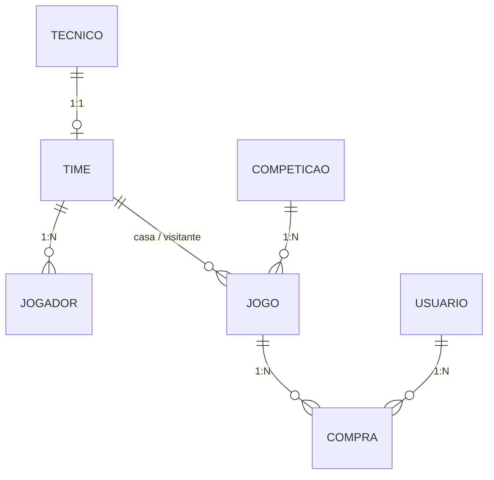

# ⚽ Futsal Manager

Aplicação web para **gestão de competições de futsal e venda de ingressos**, desenvolvida para a disciplina de Desenvolvimento Web 1 (DW1) em arquitetura **Cliente/Servidor** com padrão **MVC**, **Node.js + Express** e **PostgreSQL**. A organização das pastas segue o projeto modelo **CandyShop**.

## Funcionalidades

**Visão do cliente**
- Cadastro e login (sessão por cookie)
- Vitrine de partidas com filtro por competição e barra de lotação
- Compra de ingressos (1 a 6 por compra) com **pagamento simulado** (PIX, cartão ou boleto)
- "Meus ingressos": histórico e cancelamento de compras

**Visão administrativa**
- CRUD de partidas, times (com upload de logo), jogadores (com upload de foto), técnicos e competições
- Painel de vendas: receita, ingressos vendidos, cancelamentos e lista de todas as compras

**Regra de negócio principal (venda de ingressos):** o servidor valida a quantidade, a forma de pagamento, se a partida ainda não aconteceu e se ainda há ingressos disponíveis. A checagem de lotação é feita dentro de uma **transação** com `SELECT ... FOR UPDATE`, evitando vender além da capacidade em compras simultâneas.

## Estrutura do projeto

```
futsal-project
├── backend
│   ├── controllers/      (auth, tecnico, time, jogador, competicao, jogo, compra)
│   ├── middlewares/      (auth.js: sessão por cookie, exigirLogin e exigirAdmin)
│   ├── routes/
│   ├── database.js       (conexão PostgreSQL via .env)
│   ├── erros.js          (erros do banco -> respostas HTTP amigáveis)
│   ├── imagens.js        (redimensiona e salva uploads com sharp)
│   ├── server.js
│   └── .env
├── documentacao          (init.sql, diagrama do banco, checklist, enunciado)
├── frontend
│   ├── comum/            (comum.css e comum.js compartilhados)
│   ├── login/ cadastro/ menu/ jogos/ meus_ingressos/
│   └── partida/ time/ jogador/ tecnico/ competicao/ vendas/
├── imagens               (logos, fotos e silhueta padrão)
├── index.html
├── package.json
└── README.md
```

## Modelo de dados

Diagrama completo em [`documentacao/DIAGRAMA_BD.md`](documentacao/DIAGRAMA_BD.md).



- **Independente:** `competicao`
- **1:1:** `tecnico` ↔ `time` (`time.id_tecnico` é `UNIQUE`)
- **1:N:** `time` → `jogador`, `competicao` → `jogo`, `usuario` → `compra`, `jogo` → `compra`

## Como executar

1. Instale as dependências: `npm install`
2. Crie o banco no PostgreSQL: `CREATE DATABASE futsal_db;`
3. Conecte-se ao `futsal_db` e execute `documentacao/init.sql` (cria as tabelas e carrega os dados iniciais)
4. Copie `backend/.env.example` para `backend/.env` e ajuste a senha do seu PostgreSQL:
   ```
   DB_HOST=localhost
   DB_PORT=5432
   DB_NAME=futsal_db
   DB_USER=postgres
   DB_PASSWORD=sua_senha
   PORT=3001
   COOKIE_SECRET=troque-este-segredo
   ```
5. Inicie: `npm start` (ou `npm run dev`)
6. Abra **http://localhost:3001** no navegador (acesse sempre por esse endereço, pois o cookie de sessão depende dele)

### Dados iniciais (LNF)

O `init.sql` carrega as **16 equipes da LNF 2026**, seus técnicos e **434 jogadores**, coletados em https://lnfoficial.com.br/equipes/ (nome do jogador = apelido usado pela liga; data de nascimento e foto não constam no site). As partidas são os jogos reais dos playoffs da LNF Cresol 2026, incluindo a final (Magnus x Joinville, 05/12 e 12/12). Os **preços dos ingressos e as logos são exemplos**: troque as logos pelo upload na tela de Times.

### Usuários de demonstração

| Perfil | E-mail | Senha |
|--------|--------|-------|
| Administrador | admin@futsal.com | admin123 |
| Cliente | mariana@email.com | cliente123 |

Novos clientes podem se cadastrar pela página "Criar conta".

## Login e cookies

- `POST /api/auth/login` valida e-mail e senha (hash SHA-256) e grava o cookie `sessao`.
- O cookie é **assinado** (`cookie-parser` + `COOKIE_SECRET`) e **`httpOnly`**, expira em 2 horas e contém id, nome e perfil.
- `exigirLogin` e `exigirAdmin` (em `backend/middlewares/auth.js`) protegem as rotas. O frontend também esconde o que não é do perfil, mas **quem manda é o servidor**.
- `POST /api/auth/logout` apaga o cookie.

## Principais rotas da API

| Recurso | Rotas | Acesso |
|---------|-------|--------|
| Auth | `POST /api/auth/login`, `/logout`, `/registrar`; `GET /api/auth/me` | público / logado |
| Técnicos, Times, Jogadores, Competições, Partidas | `GET /api/<recurso>` e `/:id` | logado |
| | `POST`, `PUT /:id`, `DELETE /:id` | admin |
| Imagens | `POST /api/times/:id/imagem`, `POST /api/jogadores/:id/imagem` | admin |
| Compras | `POST /api/compras`, `GET /api/compras/minhas`, `PUT /api/compras/:id/cancelar` | logado |
| | `GET /api/compras`, `GET /api/compras/resumo` | admin |

Exemplos de chamadas em [`documentacao/REQUISICOES_EXEMPLO.md`](documentacao/REQUISICOES_EXEMPLO.md).

## Tecnologias

Node.js, Express, PostgreSQL (`pg`), `cookie-parser`, `multer`, `sharp`, HTML5, CSS3 e JavaScript puro.

## Autor

João Felipe - DW1 - 4º Bimestre - 2026
