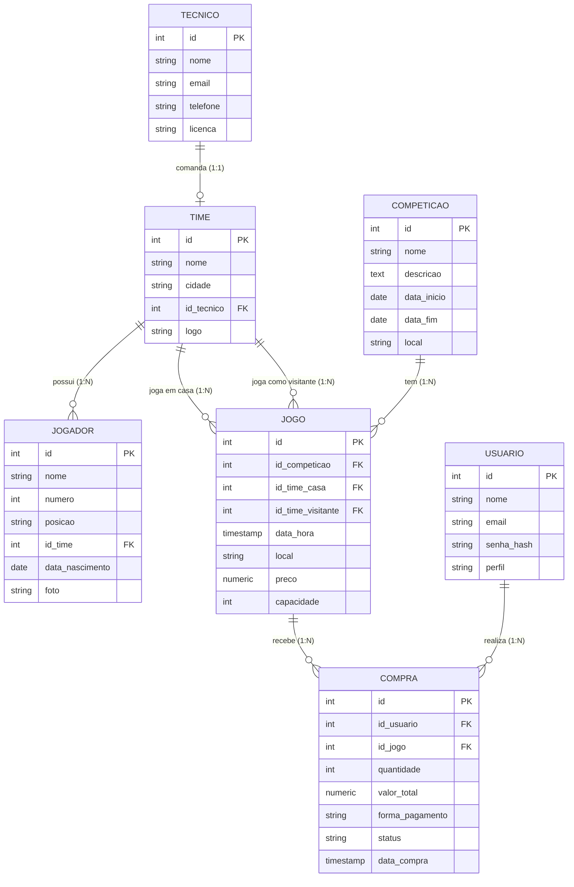

# Diagrama do Banco de Dados - Futsal Manager

## Relacionamentos exigidos no enunciado

| Tipo | Onde |
|------|------|
| Tabela independente | `competicao` (e `usuario`) |
| 1:1 | `tecnico` ↔ `time` (`time.id_tecnico` é `UNIQUE`) |
| 1:N | `time` → `jogador`, `competicao` → `jogo`, `usuario` → `compra`, `jogo` → `compra` |

Valores válidos: `usuario.perfil` = `admin` ou `cliente`; `compra.forma_pagamento` = `PIX`, `CARTAO` ou `BOLETO`; `compra.status` = `PAGO` ou `CANCELADO`.
